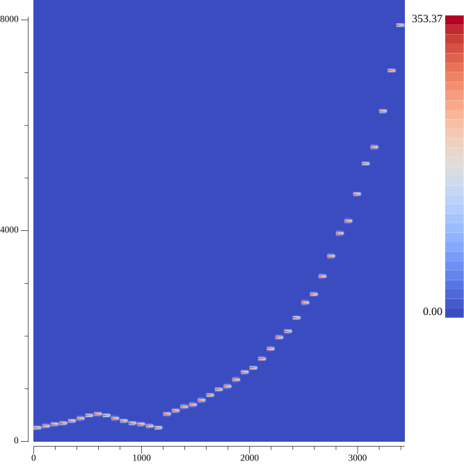
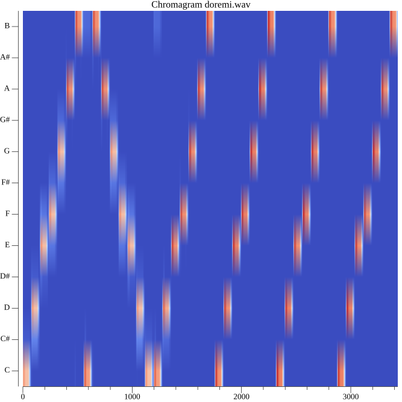

# musiclab

Audio analysis and fingerprinting toolkit in Go.

## Features

- **Chromaprint fingerprinting** -- drop-in replacement for `fpcalc` (same output formats: text, JSON, raw)
- **AcoustID lookup** -- identify songs online (AcoustID fingerprint matching + MusicBrainz metadata)
- **Spectral hash database** -- index a music library and find sample matches
- **FFT analysis** -- detect dominant frequencies and musical notes
- **Visualizations** -- chromagram and spectrogram heatmaps (PNG)
- **Synthesis** -- generate WAV files from musical score CSV or MIDI with SoundFont rendering
- **Guitar tabs** -- generate tabs from MIDI/score (Viterbi DP), parse ASCII tabs to CSV/MIDI
- **Transcription** -- detect pitches in monophonic audio and output note/duration CSV

## Build

```bash
make build
```

## Commands

| Command | Description |
|---|---|
| `fingerprint` | Generate Chromaprint fingerprint, optionally look up on AcoustID |
| `db` | Build spectral hash database from a music folder |
| `samplematch` | Find where a sample occurs in a reference file or database |
| `fft` | Analyze dominant frequencies and musical notes |
| `chromagram` | Generate a chromagram heatmap (PNG) |
| `spectrogram` | Generate a spectrogram heatmap (PNG) |
| `doremi` | Synthesize WAV from a musical score CSV |
| `midi` | Render score CSV or MIDI files with SoundFont instruments |
| `transcribe` | Detect pitches in monophonic audio, output note/duration CSV |
| `tabs` | Generate guitar tabs from MIDI or score (Viterbi DP optimization) |
| `tab2csv` | Parse ASCII guitar tabs to CSV and MIDI |

## Quick Start

```bash
# Fingerprint a song
musiclab fingerprint song.mp3

# Look up on AcoustID
export ACOUSTID_API_KEY=your_key
musiclab fingerprint song.mp3 --lookup

# Build spectral database and match a clip
musiclab db --scan --music-root ~/Music --db spectr.db
musiclab samplematch --in spectr.db --db --sample clip.wav

# Visualize
musiclab chromagram --in song.wav --out chroma.png
musiclab spectrogram --in song.wav --out spectr.png
```

## Visualizations

Spectrogram:



Chromagram:



## Documentation

- [docs/DESIGN.md](docs/DESIGN.md) -- architecture and data flow diagrams
- [docs/HOWTO.md](docs/HOWTO.md) -- detailed usage instructions

## Supported Formats

MP3, FLAC, WAV, OGG (Vorbis/Opus). Requires CGo for FLAC (libflac) and MP3 (mpg123) decoders.
