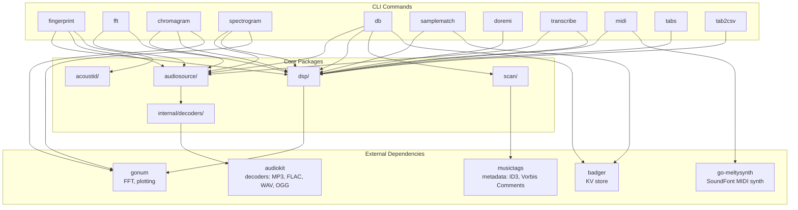
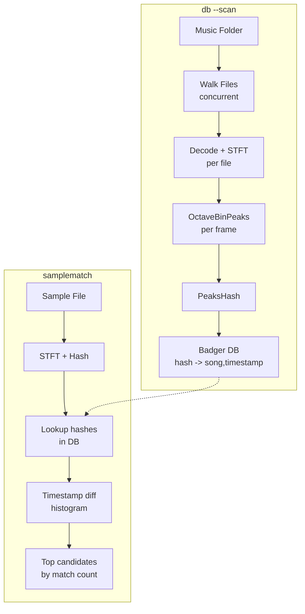
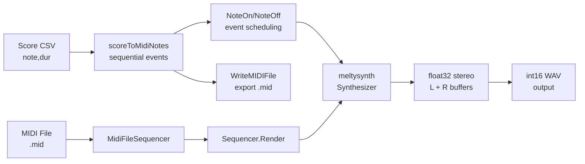
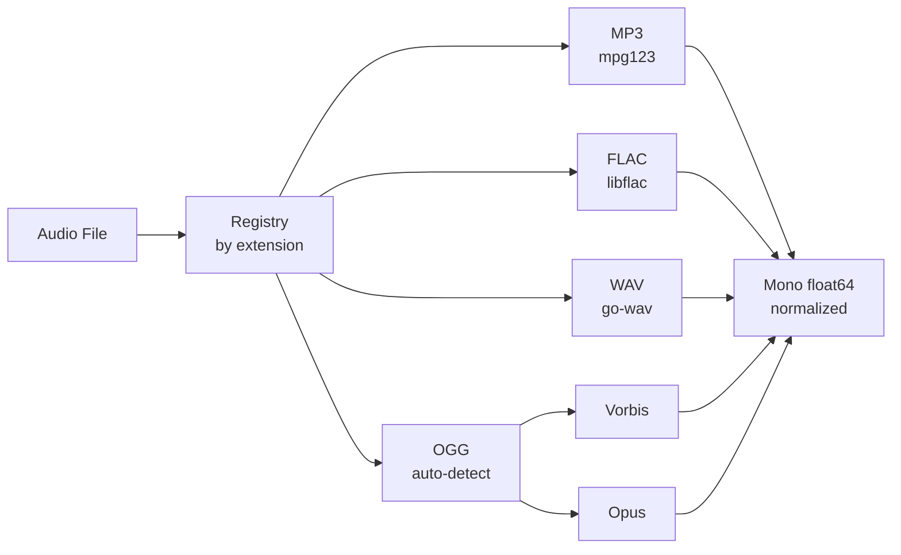
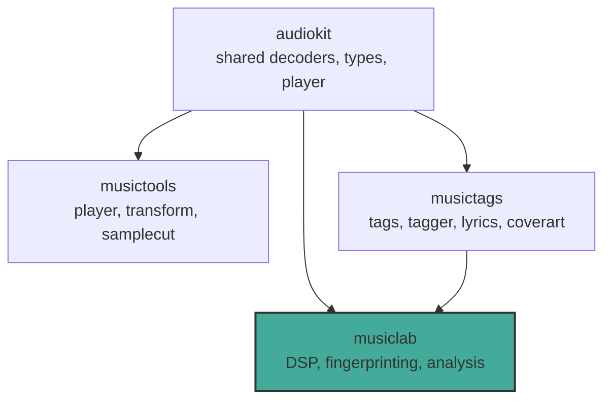

# musiclab Design

Audio analysis and fingerprinting toolkit written in Go.

## Architecture Overview

## Data Flow Pipelines

### Chromaprint Fingerprinting

```mermaid
flowchart LR
    A[Audio File] --> B[Decode<br/>MP3/FLAC/WAV/OGG]
    B --> C[Mono Mix<br/>int32 accumulation]
    C --> D[Resample<br/>to 11025 Hz]
    D --> E[Hamming Window<br/>+ FFT]
    E --> F[Energy Spectrum]
    F --> G[Chroma Features<br/>12 bins]
    G --> H[ChromaFilter<br/>coeffs: 0.25 0.75 1.0 0.75 0.25]
    H --> I[Normalize<br/>Euclidean norm]
    I --> J[Integral Image]
    J --> K[16 Classifiers<br/>algorithm 2]
    K --> L[Subfingerprints<br/>32-bit each]
    L --> M[Base64 Encode<br/>with compression]
```

**Key parameters:**
- Sample rate: 11025 Hz
- FFT frame size: 4096 samples
- Hop size: 1365 samples (frame_size / 3)
- Max duration: 120 seconds
- Resampler: polyphase Kaiser-windowed sinc (beta=9, cutoff=0.8, filter_length=16)

### Spectral Hash Database (db + samplematch)

**Spectral hash scheme:**
- STFT: 2048-sample frames, 441-sample hop
- 8 octave bins: below C2, C2-C3, C3-C4, C4-C5, C5-C6, C6-C7, C7-C8, above C8
- Peak frequency per bin (largest amplitude wins)
- Hash: concatenated peak frequencies with LSB cleared, base-1000 encoding

### MIDI / SoundFont Rendering

**Pipeline:**
1. Score CSV is parsed into sequential `MidiNote` events (note, velocity, startMs, durMs)
2. Events are sorted by sample position and scheduled as NoteOn/NoteOff calls
3. go-meltysynth synthesizer renders audio between events using SoundFont instrument samples
4. Float32 stereo output is converted to 16-bit interleaved WAV

**MIDI export:** Score CSV can also be exported as standard MIDI files (Format 0, 480 ticks/quarter) via `dsp.WriteMIDIFile`, independent of SoundFont rendering.

### Audio Decoding

Supports 16-bit, 24-bit, and 32-bit audio. Multi-channel audio is mixed to mono using int32/int64 accumulation (avoids int16 overflow).

## Package Responsibilities

| Package | Purpose |
|---|---|
| `dsp/` | Signal processing: FFT, STFT, chroma, fingerprinting, resampling, synthesis (Karplus-Strong), MIDI file writing, note utilities |
| `audiosource/` | Decode audio files to mono float64 samples |
| `acoustid/` | AcoustID REST API client for online fingerprint lookup |
| `scan/` | Concurrent music directory walker with metadata extraction |
| `internal/decoders/` | Decoder registry wrapping audiokit codec implementations |

## Project Ecosystem

**musiclab** focuses on audio analysis and identification. It depends on:
- **audiokit** for codec abstraction (decoders, types)
- **musictags** for metadata extraction during library scanning

Audio playback, file conversion, and segment cutting live in **musictools**.
Metadata tagging, lyrics, and cover art live in **musictags**.

## References and Inspiration

Projects and algorithms that influenced the implementation:

| Feature | Reference | What we used |
|---|---|---|
| SoundFont MIDI rendering | [go-meltysynth](https://github.com/sinshu/go-meltysynth) | SF2 loading, MIDI sequencer, real-time synthesizer |
| Guitar sound synthesis | [Karplus-Strong algorithm](https://en.wikipedia.org/wiki/Karplus%E2%80%93Strong_string_synthesis) | Plucked string waveform in doremi `--wave=guitar` |
| Guitar tab conversion | [tuttut](https://github.com/natecdr/tuttut) — HMM + Viterbi for optimal fingering | Inspired our Viterbi DP approach for `tabs` command string/fret assignment. See [comparison](TABS_COMPARISON.md) |
| Guitar tab conversion | [MidiToTabs](https://github.com/romanblack1/MidiToTabs) — MIDI to guitar tab (Python) | Reference for MIDI-to-fretboard mapping, tuning offsets, capo support |
| Audio-to-tab pipeline | [gtrsnipe](https://github.com/scottvr/gtrsnipe) — audio separation + pitch detection + tab | Reference for full audio-to-tab pipeline design (Demucs + Basic-Pitch) |
| Chromaprint fingerprinting | [Chromaprint](https://acoustid.org/chromaprint) (C reference implementation) | Ported algorithm to Go: chroma features, classifier, base64 encoding. Drop-in `fpcalc` replacement (text, JSON, raw output formats) |
| Audio fingerprinting | [AcoustID](https://acoustid.org/) | Online lookup API for fingerprint-to-metadata matching |
| Tab-to-MIDI reference | [Sarath18/tab2midi](https://github.com/Sarath18/GuitarTabsToMidi) (Python) | Validated our tab2csv output against reference implementation (100% note match) |
